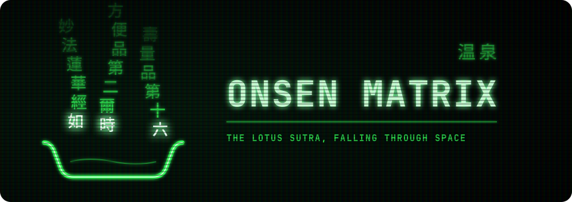

  

**The Matrix the way I remember it: a three-dimensional space you fly through, columns of the Lotus Sutra falling like cherry blossoms, each character glowing like living code.**

https://github.com/user-attachments/assets/ffd5f987-348c-4c74-a494-2e9fdc4314a7

One scene, spanning every display at once. Built with no ceiling: Rust on the Bevy engine, one draw call for the whole rain, 60 fps on three 4K displays at under half of a moderately specced GPU.

## What it is

- **A space, not a wallpaper.** You drift forward through rain that reaches far into the distance, near glyphs large and far ones small.
- **The Lotus Sutra as living code.** The Hōben and Juryō chapters in Kumārajīva's Chinese: 744 characters, each glyph reading on as it fades.
- **Phosphor, not pixels.** Every character glows like a tube: a soft aura, scattered light and a sharp core, under an aperture grille and rolling scanlines.
- **One picture across every display.** All your screens become one canvas with no seam. Choose them by make and model, not by which port they're in.
- **Gone the instant you touch anything.** Any key but the now-playing panel's, any click, scroll or pointer movement ends it, and so does the session lock. After half an hour it locks the session and turns the displays off, in that order and at once; the first touch afterwards wakes them into the lock screen.
- **What's playing, in the picture.** The track your browser or player is on, with its thumbnail, title, artist and position, fading in at the bottom centre when the track changes and out again after ten seconds, read the way the Omarchy bar reads it. Space brings it back; with it there, Space plays or pauses, the arrows skip, Shift+Space sends it away. One line in the config turns it off.
- **Light on the machine.** It polls nothing, and the whole rain is a single draw.
- **Tuned in one file.** Density, speed, depth, frame rate and run length all live in one commented config.

## Install

Three dependencies, one command.

    git clone https://github.com/lkingland/onsen-matrix
    cd onsen-matrix
    makepkg -D pkg -si

That gives you `onsen-matrix`, which takes every display, and
`onsen-matrix --outputs 'desc:LG Electronics'` for only the ones you name,
by make and model or connector. It needs Hyprland, a Vulkan driver and the
Noto CJK fonts, and touches nothing else on your system.

### What the command does

It is an ordinary Arch package, built from the checkout you are standing in.
`-D pkg` points makepkg at [`pkg/PKGBUILD`](pkg/PKGBUILD), `-s` fetches the
one build dependency (`cargo`), `-i` installs the result with pacman. Inside:

1. **The version is computed, not typed.** `pkgver()` joins the version in
   `Cargo.toml` with the commit count and short hash of the checkout's
   `HEAD`: `1.0.0.r80.g28cf6ccf`. `pacman -Q onsen-matrix` therefore names
   the commit that is running, and a mismatch with `git rev-parse --short=8
   HEAD` is visible at a glance.
2. **The build happens in the checkout's own `target/`**, as
   `cargo build --release --locked`. That makes an install incremental with
   the dev loop's build: seconds after a small change, four minutes or so
   only after `cargo clean` or a fresh clone. It also means `target/` is
   where the gigabytes live; the checkout itself is a few megabytes.
3. **The tests run** (`cargo test --release --locked --workspace`); a
   failing test fails the install.
4. **Seven files are packaged, and nothing else:** the binary at
   `/usr/bin/onsen-matrix`; the shader and the two sutra texts under
   `/usr/share/onsen-matrix/assets/`; the example config at
   `/usr/share/onsen-matrix/config.toml`; this README under
   `/usr/share/doc/onsen-matrix/`; the licence under
   `/usr/share/licenses/onsen-matrix/`. No unit files, no udev rules, no
   Hyprland or idle configuration, nothing under `/etc`.
5. **pacman installs it as an explicit package**, so an orphan sweep never
   removes it, and `pacman -Rns onsen-matrix` removes it completely.

### What the binary does at launch

- **Assets** are found at `ONSEN_MATRIX_ASSETS` if set, else
  `/usr/share/onsen-matrix/assets`, else the source tree it was compiled
  from. Installed, the second wins. The shader is an asset, so the installed
  binary runs the installed shader: editing the checkout's shader changes
  nothing on the menu until the next install.
- **Settings** come from `ONSEN_MATRIX_CONFIG` if set, else
  `~/.config/onsen-matrix/config.toml`. No file means the defaults, which
  are exactly what the shipped `config.toml` lists; a key left out keeps its
  default. `--outputs`, `--exclude`, `--fps` and `--limit` override the file
  for one run, which is how a menu entry pins it to particular displays
  without any config file at all.
- **Displays** are chosen by asking Hyprland for each output's make and
  model (`hyprctl monitors -j`), matching the selectors, and opening one
  borderless fullscreen window per monitor, placed by monitor name. No
  window rules, no focus dance, no special workspace.
- **Logging** goes to the terminal when stderr is one, and otherwise, which
  is the menu's case, to `~/.local/state/onsen-matrix/log`, overwritten each
  run. The `rain:` lines and the reason the run ended are there.
- **While it runs** it holds a Wayland idle inhibitor, so the stock
  screensaver and the lock do not fire over it. It ends on any key
  but the panel's (Space, and the arrows and Shift+Space while the panel
  is in), on any click, scroll or pointer movement, on losing focus (which
  is what the lock does to every window), or at the half-hour limit. At
  the limit it first runs the command `run.then` names in the config: by
  default the session lock, a one-second settle, then the display-off
  command, so the outputs get no signal at all from the moment the run
  ends, and the first touch afterwards wakes them into the lock screen.
  (Omarchy's own lock would show its lock screen for five seconds before
  blanking.) Without the hand-over the idle timers the run held back would
  start again from zero, and the displays would stay lit through the stock
  screensaver until Omarchy's own lock time. Set `then = ""` to just stop.
  Its window class is `onsen-matrix`, not Omarchy's screensaver class, so
  Omarchy's own screensaver machinery neither launches it nor kills it.

### Making a change live

`bin/dev` and `bin/install` are the two ends of the loop and they never touch
each other's binary.

- `bin/dev` builds the checkout and runs `target/release/onsen-matrix` on a
  test display with `--hold`, which disables every way a run can end, takes
  no keyboard focus, and reads the checkout's shader live (a saved shader
  reloads in place). It never writes to `/usr/bin`.
- The menu and the launcher run `/usr/bin/onsen-matrix`, the installed
  package, always. Nothing installs on its own: not a save, not a commit,
  not a push.
- `bin/install` is therefore the step that makes a change real. It runs the
  same makepkg with `-f` (rebuild even when a package of this version
  exists), deletes the tarballs makepkg leaves in `pkg/`, and prints the
  installed version beside the checkout's `HEAD`.

So the cycle is: edit, `bin/dev` to look, commit, `bin/install`, and the
next launch from the menu shows the new build. A run already on screen
keeps the old binary until it ends.

One nuance of the version label: the package is built from the **working
tree**, but named after **`HEAD`**. With uncommitted changes the package
contains them while its label points at the last commit (`bin/install`
warns). Commit first, then install, and the label and the contents agree.
In a jj colocated checkout, git's `HEAD` is the parent of jj's working-copy
commit (`@-`), so what jj holds in `@` is in the package and not in its
label until it is squashed or described into a commit of its own; a
bookmark is not needed, the hash alone names the tree.

## Pairs with Omarchy

It pairs best with [Omarchy](https://omarchy.org): it is the screensaver of
[Onsen](https://github.com/lkingland/onsen), an Omarchy edition, where it
sits in the Super+Esc menu under System. On any Omarchy, a one-line menu
extension puts it there too. The quickest route of all: point your agent at
this repository and ask for it.

### How Onsen wires it in

Two declarations, no mechanism, and it is never the idle screensaver: idle
still launches Omarchy's stock one, and Onsen Matrix runs only when chosen.

- **A menu entry.** Onsen's `config/omarchy/extensions/omarchy-menu.jsonc`
  carries `system.onsen-matrix`: a lotus icon, the label "Onsen Matrix", and
  the action `onsen-matrix --outputs 'desc:LG Electronics'`. Its `when`
  condition is `command -v onsen-matrix`, evaluated each time the menu
  opens. The entry exists while the binary is on the PATH and vanishes when
  it is not. That test is the whole registration; nothing else records that
  the screensaver is installed. The shell reads menu extensions live, so a
  change to the file lands the moment it is saved. On a plain Omarchy, the
  same one entry in `~/.config/omarchy/extensions/omarchy-menu.jsonc` does
  the same.
- **A package declaration.** Onsen's package list carries
  `local:onsen-matrix`. The `local:` form means built by hand from its own
  checkout: the drift check accepts the installed package as intended,
  `onsen update` never installs, builds or updates it, and `onsen update`
  names it when it is missing. On a rebuilt machine that message is the
  cue to clone this repository and run `bin/install`.

Why a menu entry and not the default: running under Omarchy's screensaver
window class gets the window floated onto a special workspace by the
compositor's rules, and the stock screensaver's lifecycle (launch on idle,
kill on input) is Omarchy's to own. Keeping its own class and an opt-in
entry leaves all of that untouched, which is why the package can promise to
touch nothing on the system.

## Tune

Copy [`config.toml`](config.toml) to `~/.config/onsen-matrix/` and change
what you like: how dense the rain is and how fast it gathers, how fast it
falls, the frame rate, how far it reaches, how long a run lasts. Every setting is in there at its
default, explained. On the command line, `--outputs`, `--exclude`, `--fps`
and `--limit` override the file for one run.

## How it works

[ARCHITECTURE.md](ARCHITECTURE.md) is how it works, what every knob does,
and the numbers from a burn-in. The look lives in one shader file that
reloads as you save, so tuning it is editing a constant and looking up.

## License

MIT. The text is the Hōben and Juryō chapters of the Lotus Sutra, in
Kumārajīva's Chinese.
